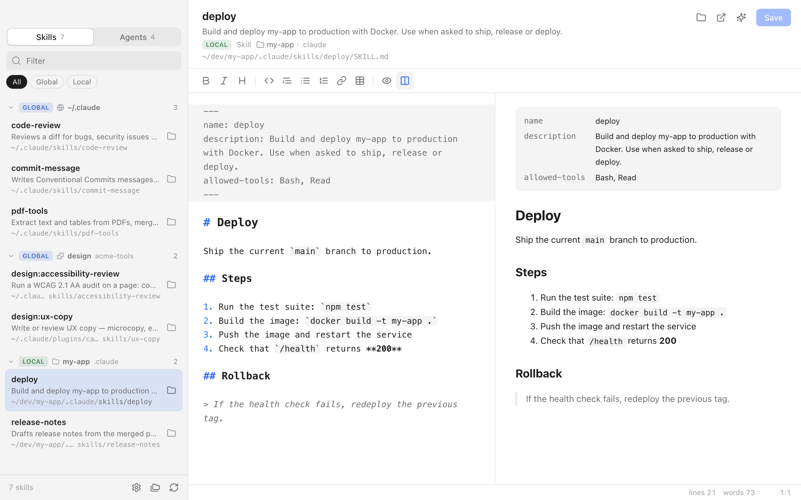

# Skills Book

[](https://github.com/pyxel-dev/skills-book/actions/workflows/build.yml)

Electron app (macOS / Windows) that lists the skills and agents on your machine and lets you edit them as Markdown.

<picture>
  <source media="(prefers-color-scheme: dark)" srcset="docs/screenshot-dark.png">
  
</picture>

```bash
npm install
npm start
```

## Build

```bash
npm run dist:mac   # dmg arm64 + x64
npm run dist:win   # NSIS installer x64 + arm64 (run on Windows)
```

Output goes to `dist/`. Builds are not signed with a developer certificate (ad-hoc signature on macOS).

## Downloads

Get the installers from the [latest release](https://github.com/pyxel-dev/skills-book/releases/latest):

- `skills-book-<version>-mac-arm64.dmg` (Apple Silicon) and `skills-book-<version>-mac-x64.dmg` (Intel)
- `skills-book-<version>-win-setup.exe`: NSIS installer (x64 + arm64)

Since the builds are unsigned:

- **macOS**: after copying the app to Applications, run `xattr -cr "/Applications/Skills Book.app"` once, otherwise macOS reports it as damaged.
- **Windows**: SmartScreen shows a warning; choose *More info* → *Run anyway*.

## Updates

At launch, the app checks the latest GitHub release (pre-releases excluded). You can also check by hand: *Skills Book → Check for Updates…* on macOS, *Help → Check for Updates…* on Windows. When a newer version exists, *Update and Restart* downloads the installer for your system, verifies its SHA-256 digest against the release, installs it and restarts the app:

- **macOS**: the new app is copied next to the installed one and swapped in when the app quits. Squirrel.Mac (electron-updater) can't be used without a Developer ID signature. If the app can't replace itself (read-only folder, launched from the disk image), the disk image is opened for a manual install.
- **Windows**: the NSIS installer runs silently (`/S --updated --force-run`) and relaunches the app.

Unsaved changes trigger the usual save prompt first; cancelling it postpones the update until the app quits. The updater ships with 0.3.0: older versions must be updated manually once.

To test without publishing, serve a JSON file in the GitHub release format and run `SKILLS_BOOK_UPDATE_FEED=http://localhost:8080/latest.json npm start` (ignored in packaged builds).

## Releasing

Every pull request to `main` must bump `version` in `package.json`: the required **Version bump** check ([`version-check.yml`](.github/workflows/version-check.yml)) fails if the version is not greater than the one on `main`, if `package-lock.json` is out of sync, or if the tag already exists.

```bash
npm version patch --no-git-tag-version   # or minor / major
```

Merging the pull request runs [`build.yml`](.github/workflows/build.yml): it builds macOS and Windows, then publishes the GitHub release `v<version>` with the installers and auto-generated notes. Versions with a pre-release suffix (`1.2.0-beta.1`) are published as pre-releases. Running the workflow by hand from the Actions tab only builds (artifacts kept 30 days), without a release.

## How it works

- **Skills / Agents tabs**. Skill = folder containing a `SKILL.md`. Agent = `.md` file with frontmatter inside an `agents/` folder of `.claude` or of a plugin (subfolders included).
- **Scope**:
  - `Global`: under a config folder in your home directory (`~/.claude`, `~/.codex`, `~/.agents`…), installed plugins included.
  - `Local`: under `<project>/.claude` (or `.codex`, `.agents`…).
  - `Other`: any folder outside a config folder.
  Collapsible groups by source (config, plugin, project), with an All / Global / Local filter.
- **Scanned folders** (button at the bottom of the sidebar): by default `~/.claude/skills`, `~/.claude/agents`, `~/.claude/plugins`, `~/.agents/skills`, `~/.codex/skills`. Add `~/dev` (or similar) to see the local skills/agents of your projects. Config is stored in `userData/config.json`.
- Recursive scan (depth 9), skips `node_modules`, `.git`, `dist`, `build`, etc. In `~/.claude/plugins`, only what is actually loaded is listed (`cache/`, `synced/`), not the `marketplaces/` catalog or orphaned versions (`.orphaned_at`). Symlinks are followed and duplicates merged.
- **Language**: picker at the bottom of the sidebar (English by default, French). Covers the UI, native dialogs and menus; the choice is saved in `config.json`.
- Name and description come from the frontmatter (`name`, `description`), otherwise from the folder/file name.
- EasyMDE editor: preview, side by side, frontmatter rendered as a table in the preview.
- Saving: original line endings are kept (LF/CRLF), external changes are detected (auto-reload when there are no local edits, otherwise a choice between Overwrite / Reload).

## Shortcuts

| | |
|---|---|
| `⌘/Ctrl S` | Save |
| `⌘/Ctrl F` | Filter the list |
| `⌘/Ctrl R` | Rescan |
| `⌘/Ctrl O` | Add a folder |
| `⌘/Ctrl P` | Preview |
| `F9` | Side by side |

## Structure

```
src/
  main.js                 main process, IPC, menu, dialogs
  preload.js              API exposed through contextBridge
  scanner.js              finds skills (SKILL.md) and agents
  updater.js              update check, download and install (Electron side)
  update-core.js          GitHub release lookup, asset choice, download + SHA-256, bundle swap
  shared/frontmatter.js   minimal YAML parser (main + renderer)
  shared/i18n.js          translations (main + renderer): adding a language = one entry in LANGS + dict
  shared/semver.js        semver parsing/comparison (updater + version check)
  renderer/               UI (HTML/CSS/JS, no bundler)
test/                     node --test (npm test)
```

Security: `contextIsolation`, `sandbox`, no `nodeIntegration`, strict CSP. The main process only allows reading/writing files returned by the latest scan.
